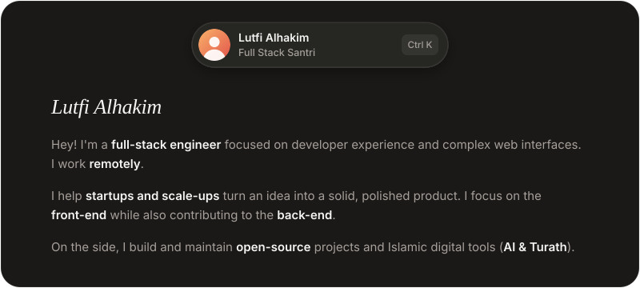
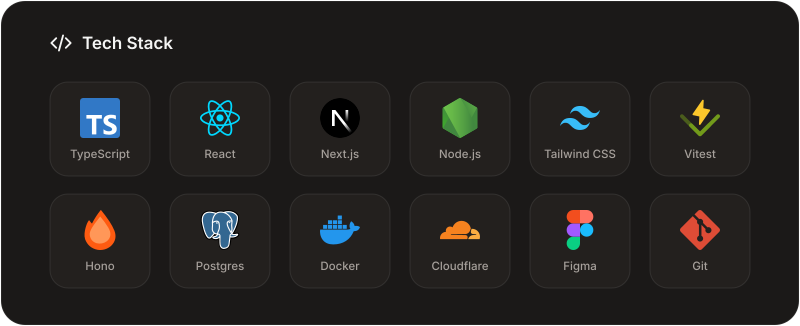

<a href="https://santri.vip">
  <picture>
    <source media="(prefers-color-scheme: dark)" srcset="./assets/hero-dark.svg" />
    <source media="(prefers-color-scheme: light)" srcset="./assets/hero-light.svg" />
    
  </picture>
</a>

 

  <a href="https://santri.vip">
    <picture>
      <source media="(prefers-color-scheme: dark)" srcset="./assets/btn-website-dark.svg" />
      
    </picture>
  </a>
  &nbsp;
  <a href="mailto:lutfialhakim16@gmail.com">
    <picture>
      <source media="(prefers-color-scheme: dark)" srcset="./assets/btn-email-dark.svg" />
      
    </picture>
  </a>
  &nbsp;
  <a href="https://x.com/lutfialhakim_">
    <picture>
      <source media="(prefers-color-scheme: dark)" srcset="./assets/btn-x-dark.svg" />
      
    </picture>
  </a>
  &nbsp;
  <a href="https://instagram.com/lutfialhakim_">
    <picture>
      <source media="(prefers-color-scheme: dark)" srcset="./assets/btn-instagram-dark.svg" />
      
    </picture>
  </a>

 

<picture>
  <source media="(prefers-color-scheme: dark)" srcset="./assets/divider-dark.svg" />
  
</picture>

 

<picture>
  <source media="(prefers-color-scheme: dark)" srcset="./assets/stack-dark.svg" />
  <source media="(prefers-color-scheme: light)" srcset="./assets/stack-light.svg" />
  
</picture>

 

<picture>
  <source media="(prefers-color-scheme: dark)" srcset="./assets/divider-dark.svg" />
  
</picture>

### ✦ Open-Source & Featured Repositories

| Repository | Description | Stack |
| :--- | :--- | :--- |
| **[santri.vip](https://santri.vip)** | Personal portfolio, digital workspace & Islamic tech experiments | `Go` `TypeScript` `Tailwind CSS` |
| **[lutfialhakim.github.io](https://github.com/lutfialhakim/lutfialhakim.github.io)** | Personal web utilities & **Dua Kulah Calculator** | `HTML` `CSS` `JavaScript` |
| **[dnn](https://github.com/lutfialhakim/dnn)** | Deep Neural Network experiments & diabetes prediction model | `Python` `TensorFlow` `Keras` |
| **[ml](https://github.com/lutfialhakim/ml)** & **[ml2](https://github.com/lutfialhakim/ml2)** | Machine Learning classification models (SVM & Perceptron with Streamlit) | `Python` `scikit-learn` `Streamlit` |
| **[PVisual](https://github.com/lutfialhakim/PVisual)** | Desktop applications & Islamic prayer schedule (*Jadwal Sholat*) | `C#` `.NET` |

 

  © Copyright 2026 — All rights reserved, <a href="https://santri.vip"><b>Lutfi Alhakim</b></a>

